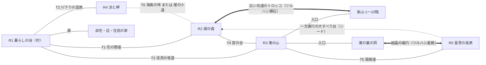

# 『宇宙人の星』マップ構造・シード地形生成 設計書 v0.3（地域マップ＋道中マップ）

- **作成日**：2026年10月16日（同日、§3.4「道具や行動で開く近道」をユーザーの指示で追加し、近道を5〜10秒で抜けられる仕掛けつきに改めた）
- **位置づけ**：ユーザーの修正指示（2026年10月16日）に従い、マップ構造を「地域マップ＋道中マップ＋特別なマップ」に改めた設計書。**v0.2（地上1枚）の §4・§5・§9・§11・§13 は本書で置き換える**（§12）。
- **作業の範囲**：設計書だけ。ゲームのコード・シーン・アセットは変更していない。
- **前提にした資料**：v0.2 と同じ（基本決定 v0.2、村マップ v0.3、宇宙生物 v0.2、釣り v0.2、時間天候 v0.2、住民生活 v0.2、鉱山 v0.4、ロケット修理 v0.2、ゲームバランス v0.2、マルチ v0.2、魚50種原本 `Docs/Specs/uchujin_no_hoshi_fish_50_design_v0_2.md`）と、現行コード（`CreatureDatabase.cs` の50種の生息条件、`FishCatalog.cs` の50種、`World/`、`Mining/`、`Residents/`）。

## 0. 記号と、決まっていること

| 記号 | 意味 |
|---|---|
| **【確定】** | 基本決定 v0.2 などで確定している事項 |
| **【ユーザー指示】** | 2026-10-16 のユーザーの指示（本書の前提） |
| **【推奨】** | 本書が推す具体案。採用は未決定 |
| **【仮数値】** | 試作で調整する数値 |
| **【変更候補】** | 既存の仕様書と食い違うため、仕様書の側を直す候補 |

**【ユーザー指示】として前提にすること**

1. 地上全体を1枚の連続マップにしない。**地域マップ**（街・森林・山岳・海岸など）と、地域を結ぶ**道中マップ**、必要に応じた洞窟・鉱山・建物内部のマップで作る。
2. 地域マップと道中マップは、それぞれ独立したプレイ可能なマップ。マップ間の移動ではエリアを切り替える。
3. 「地上1枚の内部を64m単位に分ける」方式、「400m四方を800m四方に広げるだけ」の方式は採らない。
4. 道中も一本道にしない。釣り・生物探し・採集・寄り道ができる広さを持たせ、地域とは違う役割を持たせる。
5. 地域も道中も、星のシードで地形そのものが変わる。必要な施設・生息環境・接続・到達経路は保証する。
6. 魚50種・宇宙生物50種の全100種を、どの有効なシードでも発見できる。
7. 住民は**初期10人・最大15人**（2026-10-16 の指示。実装済み）。

---

## 1. 先に結論

| 種類 | 数 | 中身 |
|---|---:|---|
| **地域マップ** | **5** | 暮らしの谷（村）・湖の森・滝の山・浜と岬・星見の高原 |
| **道中マップ** | **6** | 決まった5本＋シードで選ぶ1本（輪をつくる道） |
| **特別なマップ** | 13＋家の数 | 鉱山10階・滝の裏の洞・自宅・自分の店・住民の家（最大15） |

- **村を中心に、各地域へは道中1本で行ける**（星見の高原だけは山の奥）。普通に本道を歩けば、広場から地域の主な場所まで**走って約60〜75秒**【仮数値】。寄り道すれば、道中だけで何十分も遊べる。
- **地域は「目的地」、道中は「移り変わり」**。地域には大きな水と名物の地形と施設があり、道中には二つの地域のあいだの環境（草原・湿原・渓流・暗い谷・尾根など）がある。道中にしかいない生き物・魚の出会い方も作る。
- **水はマップをまたいでつながる**。山の泉 → 滝 → 渓流（道中）→ 村の川 → 湿原（道中）→ 河口と海。湖は暗い谷（道中）から水をもらう。マップの境目（ゲート）で、川の水面の高さと地面の高さをそろえる。
- **星の骨格（どの地域がどの方角にあり、どう結ばれ、何メートルの高さか）を先に決め、そのあとで各マップの地形を作る**。シードで骨格も各マップの地形も変わる。
- 100種は**マップ別の必須環境の一覧**（§8.3）で保証し、全マップを作ったあとに星全体で数えて検証する（§10.5）。
- **どの道中にも、最初は通れない近道が1つある**。ツルハシ・カマ・釣り竿の強化、光る子や泡を作る子を連れて行く、住民と整備する、のどれかで開き、一度開けばその星でずっと使える。開いた近道は、跳ね花・滑り台・噴き上げ泉・泡・滑車・ブランコなどの仕掛けで**道中を5〜10秒で抜けられる**。近道は時間を縮めるだけで、行けない場所は作らない（§3.4）。

---

## 2. 地域マップ（5つ）

### 2.1 一覧【推奨】

| ID | 名前（仮） | 役割 | 主な施設・場所 | 広さ【仮数値】 |
|---|---|---|---|---|
| R1 | **暮らしの谷**（村） | 毎日の生活の中心 | 広場、主人公の商店、伝言広場、種屋、雑貨屋、家具職人、共用調理場、鍛冶屋、修理屋、釣り名人の小屋、住民の家（15〜17区画）、自宅と畑、不時着地（ロケットの修理作業場）、見晴らし台、村の川 | 280 × 280 m |
| R2 | **湖の森** | 大きな湖と森。釣りと森の生き物の地域 | 湖（岬つき）、森の池2〜3、明るい林と湿った森、湖畔の東屋と桟橋 | 320 × 300 m |
| R3 | **滝の山** | 採掘と山の生き物の地域 | 鉱山の入口（→鉱山10階）、8m以上の滝と滝つぼ、滝の裏の洞の入口、渓谷、岩場、結晶の岩場、山頂 | 300 × 340 m |
| R4 | **浜と岬** | 海釣りと浜の生き物の地域 | 砂浜、岩場、岬（沖を狙える）、桟橋、河口、浜の休憩所 | 360 × 220 m |
| R5 | **星見の高原** | 静かな奥地。夜空と静けさの地域 | 平らな台地、高原の池、木立、花と風の草地、星見の岩 | 240 × 240 m |

### 2.2 なぜ5つか【推奨】

- **4つ以下**だと、湖と森、山と滝、海を同じ地域に押し込むことになり、魚50種・生物50種の環境（湖の深場・静かな岸・滝の裏・沖・静かな高台など）が一つの地域で混み合う。地域ごとの「名物」がぼやける。
- **6つ以上**だと、村からの距離が伸び、毎日の生活の行き来が重くなる。ロード（エリアの切り替え）の回数も増える。
- 5つなら、村を中心に「森と湖」「山」「海」の3方向へ出られ、その奥に「高原」がある、という分かりやすい形になる。宇宙生物仕様の5分類（農業・森草原・水辺海岸・村・地下特殊）とも自然に対応する。

### 2.3 各地域の中身

**R1 暮らしの谷（村）**
- 村の川が地域の中を流れる（瀬・淵・よどみ・水草帯・橋の岩場）。毎日の釣りはここでできる（§6 で13種）。
- 住宅地は広場のまわりと川沿い・段丘に分かれる（区画は地形に合わせる）。
- 見晴らし台は村より一段高い丘（星の光帯の夜に住民が集まる、にぎやかな高台）。
- 不時着地は村の外れの開けた草地。修理屋や住民が通う（ロケット修理仕様 §11）。
- 道中へのゲートは3か所（T1 花の野道・T2 川下りの湿原・T3 渓流の坂道）。T6 は村を通らない。

**R2 湖の森**
- v0.2 の湖（差し渡し90m以上・最深部9m以上・浅場・中層・泥の入り江・砂泥底・流れ込みの濁り・静かな岸・最深部へ届く岬）をここに置く。
- 湖のまわりに、明るい林（果樹・木漏れ日）と湿った森（倒木・苔・キノコ）。森の池2〜3（湧水口・泥底・濁り）。
- 湖畔に東屋と小さな桟橋（住民の釣り・散歩の行き先）。静かな岸は東屋の反対側。

**R3 滝の山**
- 鉱山の入口（鉱山10階へ）。山の斜面に岩場・結晶の岩場・洞穴。
- v0.2 の8m以上の滝（落差9m前後）と滝つぼ、滝の裏の洞をここに置く。滝から下流は急流で、渓流の坂道（T3）へ続く。
- 声が響く渓谷（コダマル）、山頂（見晴らしの岩）。

**R4 浜と岬**
- 河口（村の川が湿原を抜けて海へ出る所）、砂浜、岩場、岬、桟橋（沖まで届く）。
- 岬の先は風が強い（カゼウケ）。桟橋の先と岬の先が「沖」。
- 浜の休憩所（雨宿り。施設ではない小屋）。

**R5 星見の高原**
- v0.2 の静かな高台を一つの地域にした。家も施設もなく、住民は予定では来ない（固有のストーリーの時だけ）。
- 平らな台地に、高原の池・木立・花と風の草地・星見の岩。夜空がいちばんよく見える。
- 行くには滝の山から尾根道（T5）を登る。帰りは高原の縁から湖の森へ下る一方通行の大すべり台（シードで有無。§3.4）。

---

## 3. 道中マップ（6つ）

### 3.1 一覧【推奨】

| ID | 名前（仮） | つなぐ地域 | 環境 | 本道の長さ【仮数値】 | 広さ【仮数値】 |
|---|---|---|---|---:|---|
| T1 | **花の野道** | 暮らしの谷 ⇄ 湖の森 | なだらかな丘の草原と花畑、小川と浅瀬、野の池、果樹の段 | 240 m | 240 × 120 m |
| T2 | **川下りの湿原** | 暮らしの谷 ⇄ 浜と岬 | 川の下流、湿原の池（泥・葦）、砂州、朝霧 | 260 m | 260 × 130 m |
| T3 | **渓流の坂道** | 暮らしの谷 ⇄ 滝の山 | 渓流（瀬・早瀬・淵・小さな滝）、つづら折りの坂、崖、湧水の淵 | 260 m | 260 × 110 m |
| T4 | **苔の谷** | 湖の森 ⇄ 滝の山 | 暗い谷の森、湧き水の窪地、苔の倒木、光るキノコ、こだまの岩壁、静かな池 | 240 m | 240 × 100 m |
| T5 | **尾根道** | 滝の山 ⇄ 星見の高原 | 風の吹く尾根、岩の露頭、結晶の露頭、尾根の草地、眺め | 280 m | 280 × 90 m |
| T6 | **（シードで1本）** 海風の林 ／ 崖の小道 | 浜と岬 ⇄ 湖の森 ／ 浜と岬 ⇄ 滝の山 | 海風の林：風で傾いた林と砂丘・浜の池。崖の小道：海を見下ろす崖沿いの道・洞穴 | 280 m | 280 × 110 m |

広さは「長さ × 幅」。長さはゲートからゲートまでの直線の距離（ゲートは長さの両端。2026-10-17 の試作で 300m から縮めた）。本道は型によって曲がるので、実際の道のりはこれより長い（§3.3）。

T6 はどちらか1本をシードで選ぶ。どちらでも、村 → 地域 → T6 → 別の地域 → 村 と**輪のように回れる**（行きと帰りで違う道中を通れる）。

### 3.2 道中の役割（地域との違い）【推奨】

| | 地域マップ | 道中マップ |
|---|---|---|
| 目的 | 行き先。施設・大きな水・名物の地形 | 移り変わり。二つの地域のあいだの環境 |
| 施設 | ある（村）／目印の場所がある（鉱山の入口・湖の桟橋など） | ない（東屋と道標だけ） |
| 水 | 大きな水（村の川・湖・滝つぼ・海） | 小さな水（小川・野の池・湿原の池・渓流・湧水の窪地） |
| 生き物 | 地域の名物の種 | 境目の種（草原と森のあいだ、川と湿原のあいだなど）。道中が一番会いやすい種もいる |
| 住民 | 生活・仕事・趣味の場 | 行き帰りに通る。散歩・釣り・生き物探しの趣味で来る |
| 遊び方 | 目的を果たす | 寄り道・発見・ついでの釣り |

**道中が一番会いやすい種の例**：草原のピョコロ・ハナピカ（花の野道）、湿原のヌマプニ・ツユツユ（川下りの湿原）、渓流のハネウオ以外の早瀬の魚やカワハネ（渓流の坂道）、苔のモリマル・スミカゲ（苔の谷）、風のフワタネ（尾根道）。

### 3.3 道中の作り【推奨】

```
  地域A側のゲート ─────────── 本道（幅3〜4m、坂はゆるく、橋あり）────────── 地域B側のゲート
        │            │             │              │              │
     脇道へ       寄り道        東屋（雨宿り）    寄り道         隠れた場所
   （川辺へ）    ポケット                       ポケット      （崖の上・滝の裏など）
```

- **地形と道の考え方**【ユーザー指示 2026-10-17】：**先に起伏のある地形（段丘・崖・丘・谷・台地）を作り、道は後から通す**。歩きやすい坂が無ければ、道の通る所だけ段差を削って坂（切り通し・盛り土）にする。道のために地形全体をなだらかにはしない。経路は「近くに自然な坂があれば回り込み、無ければ段差に坂を作って越える」で選ぶ（坂の目安を超える高さ1mあたり、約25m遠回りするのと同じ手間として数える）。
- **本道**【ユーザー指示 2026-10-17：曲がりくねりを優先。ただし全部の道を曲げるのではない】：曲がり方は道中の型（シード）と地形で変わる。地形（段・崖・丘・小川）に沿って、坂がきつくならない道すじを選ぶので、曲がる理由が地形にある。普通に通れば走って**33〜45秒**【仮数値】。坂は 8% まで（4m の区間で 13% を超えない）。橋と浅瀬で川を渡る（小川は本道と並び続けず、何度か交わる）。分かれ道に宇宙語の道標。

  | 本道の形 | 例 | 道のり÷ゲート間の直線距離【試作の実測】 |
  |---|---|---|
  | まっすぐ寄り | T1 型0「開けた野の一本道」、湿原の土手道、尾根道 | 約1.1（直線からのずれ 平均15m） |
  | 丘や段を回り込む | T1 型1「丘を回り込む道」 | 約1.2（ずれ 平均41m） |
  | 折り返して登る | T1 型2「段丘を折り返して登る道」、渓流の坂道のつづら折り | 約1.3（最大1.5。ずれ 平均44m） |
- **脇の探索地**：本道の左右（道中の幅の大部分）が寄り道の場所。小川・池・林・岩場・草地。
- **寄り道ポケット**：1本の道中に3〜5か所（v0.2 §5.4 のポケットをこのマップの中に置く）。
- **隠れた場所**：1本に1か所。崖の上・小さな滝の裏・倒木のトンネルの先など。見えているのに、回り込まないと行けない。
- **近道**：一方通行の段差（帰りの近道）と、**最初は通れず、道具の強化や行動で開き、仕掛けで5〜10秒で抜けられる近道**（§3.4）。

### 3.4 道具や行動で開く近道【ユーザー指示 2026-10-16／中身は推奨】

**すべての道中に1つずつ**、最初は通れない近道を置く。ツルハシなどの道具を強化する、生き物を連れて行く、住民と一緒に整備する、といったことをすると通れるようになる。開いた近道は、**滑る・跳ぶ・宇宙生物の力を借りる**などの仕掛けで、道中を**5〜10秒**で抜けられる【ユーザー指示】。さらに、奥まで遊んだ人向けに、地域どうしを結ぶ**抜け道**を3つ置く。

**約束**
1. **近道は時間を縮めるだけ**。施設・必須の生息環境・修理の素材・100種のどれも、近道を開けないと行けない場所には置かない。
2. **最初から見えている**。茨・大岩・暗い穴・泡だまり・切れたロープなどが、ゲートを出てすぐの所から見え、地図アプリにも「？」の印が付く。何をすれば通れるかは、見た目と住民の身振り（鍛冶屋がツルハシを振る仕草をして岩を指さす、など）で分かるようにし、宇宙語の理解は必要にしない。
3. **一度開けば、その星ではずっと通れる**（星の状態として保存。マルチでは誰が開けても全員が通れる）。
4. **開ける手段は遊びごとに分ける**。採掘（ツルハシ）、農業（カマ）、釣り（釣り竿）、生き物取り（光る子・泡を作る子）、住民との暮らし（公共施設の整備）。どの遊びが好きな人も、どれかの近道は早めに開けられる。
5. **開く時期を散らす**。序盤・中盤・終盤に分け、遊ぶほど星の移動が楽で楽しくなっていく。
6. **5〜10秒で抜ける**。近道の入口と出口は、道中の両側のゲートのすぐそば（10m 以内）に置き、ゲートからゲートまでを5〜10秒にする（本道は33〜45秒）。

**道中の近道（6つ）**

| 道中 | 近道（仮） | 開け方 | 仕掛け | 時期 | ゲート→ゲート【仮数値】 |
|---|---|---|---|---|---:|
| T1 花の野道 | **跳ね花の谷** | **カマを「銅色」（Lv2）に強化**して、谷の入口の茨を刈る（鍛冶屋） | 茨の奥に、乗ると高く跳ね上げる大きな「跳ね花」が4つ並ぶ。花から花へぽーんと跳んで丘を越える。着く瞬間にジャンプを押すともっと高く跳び、宙に舞う花びら（飾りの材料）を拾える | 序盤 | 7秒（往復とも） |
| T2 川下りの湿原 | **泡の川くだり** | **アワリン（能力「泡を作る」）を連れて行く**。アワリンは湿原の池に一番多い（§7.3） | 川岸の泡だまりで、アワリンが大きな泡を作って主人公を包む。**下り**（村→浜）：泡ごと川面を滑るように流れ、湿原の水路を抜けて河口へ。**上り**（浜→村）：泡が海風に乗って浮き上がり、川の上をふわふわ飛んで村の橋のたもとへ | 序盤〜中盤 | 下り7秒・上り9秒 |
| T3 渓流の坂道 | **岩の滑り台と噴き上げ泉** | **ツルハシを「鋼」（Lv3）に強化**して、崖の割れ目をふさぐ大岩を砕く（鍛冶屋） | 大岩の奥は、湧き水が流れる岩の溝。**下り**（山→村）：天然の滑り台をカーブ3つで一気に滑り降り、村の川の淵へざぶん（浅い所に着く）。**上り**（村→山）：崖の中の「噴き上げ泉」3段に乗ると、水の勢いで上の段へ次々と押し上げられる | 中盤 | 下り6秒・上り8秒 |
| T4 苔の谷 | **光の洞の浮き苔** | **光る生き物（能力「光る」を持つ子：ヒカリムシ・ランプル・ハナピカなど）を連れて行く** | 尾根の下の真っ暗な洞。連れている子の光が当たると、苔がふくらんで宙に浮かぶ足場になる。浮き苔をジャンプで渡って地底の割れ目を越える（足場の間は普通のジャンプで届く。落ちても下はやわらかい苔の床で、横のゆるい坂から入口へ戻れる） | 中盤 | 8秒（往復とも） |
| T5 尾根道 | **峰渡りの滑車** | **住民とロープの滑車を整備する**（家具職人と鍛冶屋が張る。材料に、鉱山の中ほどの階の丈夫な金属の鉱石と木材を寄付） | 峰から峰へ張ったロープに滑車でつかまって渡る。**下り**（高原→山）：深い切れ目の上を一気に滑空。**上り**（山→高原）：途中の峰の「巻き上げ小屋」で引き上げてもらい、2本を乗り継ぐ | 終盤 | 下り6秒・上り9秒 |
| T6 海風の林 | **竿のブランコ** | **釣り竿を「鋼」（Lv3）に強化**する（釣り名人）。丈夫な糸になる | 浜の池の上に張り出した大木の枝へ、光る輪の所から竿の糸を投げて引っかけ、ブランコのように池を飛び越える。2本の木で2回 | 中盤 | 6秒（往復とも） |
| T6 崖の小道 | **砂すべりと潮吹き岩** | **ツルハシを「銅色」（Lv2）に強化**して、崖の上の砂岩を崩す（鍛冶屋） | **下り**（崖の上→入り江）：崩した砂の斜面を砂すべりで一気に滑り降りる。**上り**（入り江→崖の上）：入り江の「潮吹き岩」に乗ると、波が来た時（3秒ごと）に下から噴き上がる海水で崖の上へ押し上げられる | 序盤 | 下り5秒・上り8秒 |

（T6 はシードでどちらか1本なので、近道もその道中のものだけ）

**地域どうしの抜け道（3つ）**

| 抜け道（仮） | つなぐ所 | 開け方 | 仕掛け | 時期 | 時間【仮数値】 |
|---|---|---|---|---|---:|
| **古い坑道のトロッコ** | 鉱山6階の奥 ⇄ 湖の森の崖の洞 | **ツルハシを「輝石」（Lv4）に強化**し、6階の奥の固い壁を掘り抜く | 壁の向こうに残っていた古いトロッコに乗り、坑道を走り抜ける。曲がり角で鉱石の光る粒が飛び散る（触れると拾える） | 終盤 | 8秒 |
| **結晶の縦穴** | 滝の裏の洞 ⇄ 星見の高原の池のほとり | **ツルハシを「星鉄」（Lv5）に強化**し、洞の奥の結晶の壁を割る（最後の近道） | **上り**：結晶が集めた光の柱に入ると、ふわりと浮き上がって高原へ。**下り**：結晶のらせんの滑り台 | 終盤 | 上り10秒・下り8秒 |
| **高原の大すべり台**（一方通行） | 星見の高原の縁 → 湖の森 | 最初から使える（シードで有無。§2.3） | 高原の縁から湖の森まで、草の斜面の長い滑り台。浮かぶ子（フワタネ・ユメボシ）を連れていると、最後に綿毛で湖の岸までふわっと飛ぶ（おまけ） | 最初から | 8秒 |

**仕掛けの作り方の約束**
- **決まった道すじを進む乗り物にする**。跳ね花・滑り台・噴き上げ泉・泡・滑車・ブランコ・トロッコ・光の柱は、物理の計算に任せず、決まった道すじを決まった速さで進む（必ず出口に着き、壁に引っかからない）。主人公の操作は「乗る」の1つと、ジャンプの「おまけ」（もっと高く跳ぶ・飾りを拾う）だけ。
- **自分で動くのは浮き苔だけ**。普通のジャンプで届く間隔にし、落ちても痛くない・すぐやり直せる。
- **失敗しても何も失わない**。持ち物を落とさない、体力も減らない。
- **酔わせない**。カメラは後ろから追い、急に向きを変えない。乗っている間は道具・会話・持ち物を使えない（終わるとすぐ戻る）。
- **天候で止めない**（嵐の日も使える。雨の日は滑り台の水しぶきが増える、など見た目だけ変える）。
- **ゲーム内の時間もそのぶん短い**（7秒 ＝ ゲーム内 約6分）。

**開ける順の例（一人の遊び方）**

```
 序盤：カマ「銅色」→ 跳ね花の谷（湖の森がすぐ）
       アワリンを捕まえて連れて行く → 泡の川くだり（浜と岬がすぐ）
       ／ツルハシ「銅色」→ 砂すべりと潮吹き岩（崖の小道の星だけ）
 中盤：ツルハシ「鋼」→ 岩の滑り台と噴き上げ泉（滝の山・鉱山がすぐ）
       ヒカリムシを連れて → 光の洞の浮き苔
       釣り竿「鋼」→ 竿のブランコ（海風の林の星だけ）
 終盤：住民と滑車を整備 → 峰渡りの滑車（高原が近くなる）
       ツルハシ「輝石」→ 古い坑道のトロッコ、ツルハシ「星鉄」→ 結晶の縦穴
```

**住民と近道**
- 住民も、開いた近道を使う（跳ね花の谷・岩の滑り台と噴き上げ泉・峰渡りの滑車・竿のブランコ・砂すべりと潮吹き岩）。泡の川くだりと光の洞は、その能力の子を連れている住民だけが通る。
- 住民が跳ね花で跳んだり滑り台で滑ったりする姿は、見かけると楽しい場面になる（好き嫌いの手掛かりにもなる：はしゃぐ住民、怖がって本道を行く住民）。
- 滑車の整備は、今の「公共施設の発展」（村マップ仕様 §11.2、実装済みの寄付と住民の暮らしで進む仕組み）に加える。ロケット修理の必須条件にはしない。

**シードとの関係**
- 近道の**種類**は道中ごとに決めておく（どの星でも開ける順と遊びの釣り合いが同じになるように）。
- 近道の**形**は道中の地形で変わる（跳ね花の並ぶ向き、滑り台のカーブ、浮き苔の数と並び、滑車のロープの角度など）。長さは、ゲートからゲートまで5〜10秒に収まるように合わせる。
- 生成のときに、入口と出口がゲートのそばにあり、開ける前の印がゲートから見え、道すじに地形がぶつからないことを確かめる（§10.5）。

---

## 4. 星全体のマップ接続図

### 4.1 接続図【推奨】



（T6 は「浜と岬 ⇄ 湖の森」か「浜と岬 ⇄ 滝の山」のどちらか。点線はシードで変わる接続、太線は道具や行動で開く抜け道。道中の中の近道は §3.4）

### 4.2 水のつながり

```
 滝の山：泉 → 滝（9m）→ 滝つぼ → 急流
            ↓                      ↓
 苔の谷（T4）：谷の沢 → 湖の森：湖     渓流の坂道（T3）：瀬・早瀬・淵・小滝
                          ↓（流れ出し）        ↓
            花の野道（T1）：小川 →→→→→ 暮らしの谷：村の川（瀬・淵・よどみ・水草帯）
                                                ↓
                              川下りの湿原（T2）：下流・湿原の池・砂州
                                                ↓
                                   浜と岬：河口 → 海
```

湖の流れ出しは花の野道の小川になり、村の川に合流する（シードで、合流しない形もある）。

### 4.3 移動時間の目安【仮数値】

走る速さ 8m/秒（現行）、ゲーム内1時間＝現実75秒（30分/日）、エリアの切り替え1回 約0.5〜1秒。

| 区間 | 本道を普通に通って（走って） | ゲーム内 |
|---|---:|---:|
| 自宅 → 畑 → 店 → 広場 | 30秒 | 約25分 |
| 広場 → 村の川の釣り場 | 15秒 | 約12分 |
| 広場 → 湖の岬 | 約60〜75秒（村内12＋T1 33〜45＋湖の森15） | 約50〜60分 |
| 広場 → 鉱山の入口 | 約60〜75秒 | 約50〜60分 |
| 広場 → 桟橋 | 約60〜75秒 | 約50〜60分 |
| 広場 → 星見の高原 | 約110〜130秒（T3 → 山を横切る → T5） | 約1.5時間 |

毎日の生活（店・畑・広場・村の川）は村の中だけで済む。地域へ行くのは「遠出」。高原は夜の遠征。

**近道を開けた後**（§3.4。道中は5〜10秒）

| 区間 | 開ける前 | 開けた後 | 使う近道 |
|---|---:|---:|---|
| 広場 → 湖の岬 | 約60秒 | 約35秒 | 跳ね花の谷（7秒） |
| 広場 → 鉱山の入口 | 約60秒 | 約35秒 | 噴き上げ泉（8秒） |
| 広場 → 桟橋 | 約60秒 | 約37秒 | 泡の川くだり（7秒） |
| 広場 → 星見の高原 | 約110秒 | 約55秒 | 噴き上げ泉＋峰渡りの滑車（9秒） |
| 広場 → 星見の高原（結晶の縦穴を開けた後） | 約110秒 | 約45秒 | 噴き上げ泉＋結晶の縦穴（10秒） |

近道の分は村と地域の中を歩く時間が残るので、「どこへでも40秒前後」が開けきった後の目安になる。

---

## 5. マップごとの高低差と水域

高さは星全体でそろえる（ゲートの両側を同じ高さにする）。値は【仮数値】。

| マップ | 標高の範囲 | 段・崖 | 水域 |
|---|---|---|---|
| R1 暮らしの谷 | 10〜32 m | 2段（川沿いの低い段・住宅の段）＋見晴らし台の丘 | 村の川（幅5〜9m。瀬・淵・よどみ・水草帯・浅瀬2か所以上・橋2本以上）、畑の小さな池（主人公が作る） |
| T1 花の野道 | 14〜34 m | ゆるい丘。段差は低い（2〜4m の飛び降りられる段） | 小川（瀬・浅瀬）、野の池1 |
| R2 湖の森 | 22〜55 m | 湖の盆地のまわりに森の台地（35〜50m）。台地の縁に崖 | 湖（水面24m・差し渡し90m以上・最深部9〜11m）、森の池2〜3、流れ込みの小川 |
| T4 苔の谷 | 30〜70 m | 谷底を登る。両側に高さ15〜25mの岩壁 | 谷の沢（浅い）、湧き水の窪地、静かな池1 |
| R3 滝の山 | 50〜140 m | 山腹の段、渓谷、滝の崖（落差9〜18m）、山頂 | 泉、上流の急流、滝つぼ（深さ3m以上）、滝の裏の淵（別マップ）、湧水の淵 |
| T3 渓流の坂道 | 村のゲート〜村のゲート＋24〜30 m（谷の壁の上はさらに 15〜25 m 高い）【2026-10-17 試作で変更：本道を坂 11% で45秒以内に登れる高さ】 | つづら折りの坂、渓流沿いの崖、谷を横切る段（3〜5m。渓流はここで小さな滝） | 渓流（急流・早瀬・瀬・淵・岩場・滝つぼ）、湧水の淵 |
| T5 尾根道 | 90〜125 m | 細い尾根と、両側の急斜面。岩の露頭 | なし（小さな水たまりだけ） |
| R5 星見の高原 | 100〜115 m | 平らな台地。縁は崖（湖の森側に一方通行の下り道） | 高原の池（直径13〜20m） |
| T2 川下りの湿原 | 2〜12 m | ほぼ平ら。川沿いの低い土手 | 川の下流（よどみ・水草帯・砂州）、湿原の池2〜3（泥・葦・濁り） |
| R4 浜と岬 | 0〜28 m | 浜（0〜4m）、岬の崖（18〜28m） | 海（遠浅・岩場・海底近く・深場・沖）、河口、浜の池（シード） |
| T6a 海風の林 | 4〜30 m | 砂丘と林の段 | 浜の池1、小川（シード） |
| T6b 崖の小道 | 10〜60 m | 海側の崖の上の道。下の入り江へ降りられる所がある | 入り江（海） |

---

## 6. 魚50種の生息環境と配置

### 6.1 考え方

- 生息候補は原本どおり（魚50種原本 §2〜§5・§7）。釣り場のタグ（v0.2 で実装した `FishCatalog` のタグ：瀬・淵・湖の最深部・静かな岸・沖など）をそのまま使い、**どのマップのどの水に付くか**を決める。
- 一般魚は2マップ以上、希少・伝説はふさわしい1マップ以上（＋地下湖など別ルート）。
- **修理用の魚**：冷却膜の F008 は渓流の坂道（村から道中1本）に必ず置く。振動センサーの F045 も渓流の坂道（早瀬）に置く。どちらも天候に左右されない。

### 6.2 魚50種の配置表【推奨】

| ID | 名前 | 主なマップ（環境） | ほかのマップ | 条件 |
|---|---|---|---|---|
| F001 | マルコロ | R1 村の川 | T1 小川・野の池、R2 森の池 | — |
| F002 | ササヒレ | R1 村の川（水草帯） | T2 下流の水草帯 | — |
| F003 | チョロスジ | T3 渓流（瀬） | R1 村の川（瀬）、T1 小川（瀬） | — |
| F004 | ヒゲタマ | R2 湖の泥の入り江・森の池（泥底） | T2 湿原の池（泥底） | 夕方〜夜に活発 |
| F005 | フネビレ | R1 村の川 | T2 下流 | — |
| F006 | コメツブウオ | R2 森の池 | T1 野の池 | 群れ |
| F007 | ペラオビ | R2 湖 | R1 よどみ、T2 よどみ | — |
| F008 | シモマダラ | **T3 湧水の淵** | R3 湧水の淵、T4 湧き水の窪地、R2 森の池の湧水口 | 修理 R03 |
| F009 | ナガクチ | T3 岩場 | R1 橋の岩場、鉱山2・4階 | — |
| F010 | ユラシッポ | R2 湖（浅場） | — | — |
| F011 | ヤマギザ | R3 滝つぼ | T3 小さな滝・岩場 | — |
| F012 | コブヒレ | R2 湖（中層） | — | — |
| F013 | ギョロメ | R1 村の川（朝の浅瀬） | T1 小川、R2 森の池 | 朝 |
| F014 | ツノサキ | R4 浜・桟橋 | — | 夕方 |
| F015 | ニジスジ | R1 村の川 | R2 湖、T2 下流 | — |
| F016 | シオヒラ | R4 海底近く | T6b 入り江 | — |
| F017 | サンゴホホ | R4 岩場 | T6b 入り江の岩場 | — |
| F018 | ヒラボウシ | R4 砂浜（砂底） | — | — |
| F019 | シマクチ | R4 桟橋 | — | — |
| F020 | ホシマメ | T4 静かな池 | R2 森の池、鉱山2〜6階 | 夜 |
| F021 | ヒカリウオ | R1 村の川 | T1 小川、R2 森の池 | 夜 |
| F022 | クルクルウオ | R2 湖 | — | — |
| F023 | ハネウオ | R3 滝の下の急流 | T3 小さな滝の下の急流 | — |
| F024 | プクフグ | R2 森の池 | R4 海、T6a 浜の池 | — |
| F025 | リボンウオ | R2 湖（中層） | R4 沖 | — |
| F026 | モヤハキ | R2 湖の流れ込み（濁り） | T2 湿原の池（濁り） | — |
| F027 | サカサウオ | R1 よどみ | R2 湖、T2 よどみ | 逆雨で水面近くに |
| F028 | ハグルマウオ | T3 早瀬 | R3 上流、鉱山2〜8階 | — |
| F029 | ソコトビ | R4 海底・深場 | — | — |
| F030 | ハモリウオ | R2 湖の静かな岸 | T4 静かな池 | 静かな時間帯。修理 R06 |
| F031 | ホロホロウオ | T4 静かな池 | R2 森の池 | — |
| F032 | ジシャクウオ | 鉱山4〜8階 | — | — |
| F033 | クビレウオ | R1 村の川 | R4 岩場、T3 渓流 | — |
| F034 | ネジオビ | R2 湖（砂泥底） | R4 砂泥底 | — |
| F035 | カサビレ | R1 村の川（淵） | R2 湖 | — |
| F036 | クリスタルフィッシュ | 鉱山8〜10階 | — | — |
| F037 | アメシズク | T1 小川・野の池 | R1 村の川、R2 森の池 | 雨上がり |
| F038 | カゼウケ | R4 岬・桟橋 | T6a（海風の林を選んだ星） | 強風 |
| F039 | シルベフデ | 滝の裏の洞（暗い淵） | R2 夜の湖 | 夜 |
| F040 | キリガクレ | R2 霧の湖 | — | 霧 |
| F041 | イワナキ | 鉱山4〜10階 | — | 修理 R06 |
| F042 | ヨルツバサ | R4 沖・桟橋の先 | — | 夜 |
| F043 | オトナシ | R2 湖の静かな岸 | T4 静かな池、R5 高原の池 | 修理 R06 |
| F044 | ヒヤシウオ | R2 湖の深場 | 鉱山6〜10階 | 修理 R03（高品質） |
| F045 | サザナミメ | **T3 早瀬** | R4 海 | 修理 R06 |
| F046 | カガミヌシ | R2 湖の最深部（岬の先） | — | 無風 |
| F047 | ライメイウオ | R4 海 | R2 湖 | 荒天 |
| F048 | ウズシロ | R2 湖の最深部 | R4 深場 | — |
| F049 | ガンテイオウ | 鉱山10階 | — | — |
| F050 | ソラワタリ | R2 湖の広い水面 | R4 沖 | 晴れた夜（光帯で出やすい） |

### 6.3 マップごとの魚の数（主なマップ＋ほかのマップ）

| マップ | 釣れる魚（種） | 名物 |
|---|---:|---|
| R1 暮らしの谷 | 13 | 毎日の釣り（マルコロ・チョロスジ・ギョロメ・ヒカリウオ） |
| R2 湖の森 | 29 | 湖の伝説魚（カガミヌシ・ウズシロ・ソラワタリ）、霧のキリガクレ |
| R3 滝の山 | 4 | 滝つぼと急流（ヤマギザ・ハネウオ） |
| R4 浜と岬 | 16 | 海と沖（ヨルツバサ・カゼウケ・ライメイウオ） |
| R5 星見の高原 | 1（＋池の一般魚） | 静かな池のオトナシ |
| T1 花の野道 | 6 | 雨上がりのアメシズク |
| T2 川下りの湿原 | 7 | 湿原の濁り（モヤハキ） |
| T3 渓流の坂道 | 8 | 修理の魚（シモマダラ・サザナミメ）、渓流の魚 |
| T4 苔の谷 | 5 | 静かな池（ハモリウオ・ホロホロウオ・ホシマメ） |
| T5 尾根道 | 0 | （魚はいない。生き物と眺めの道中） |
| T6 | 2 | 選んだ道中による（海風の林：プクフグ・カゼウケ／崖の小道：シオヒラ・サンゴホホ） |
| 鉱山 | 8 | 地下湖（クリスタルフィッシュ・ガンテイオウ） |
| 滝の裏の洞 | 1 | シルベフデ |

---

## 7. 宇宙生物50種の生息環境と配置

### 7.1 考え方

- 生息場所は実装 `CreatureDatabase.cs` の `Areas`・`Features`・時間帯・天候をそのまま使い（データは変えない）、**各マップがどの場所の種類（AreaType）と地形要素を持つか**で配置を決める。
- 村の生き物（箱・窓・屋根・街灯）は建物のある村にだけいる。道中の東屋の灯りにはランプルも来る。
- 静かな場所の種（ユメボシ・ホシノコ）は星見の高原を主にする（住民が来ない地域）。

### 7.2 マップが持つ場所の種類【推奨】

| マップ | 場所の種類（AreaType） | 地形要素 |
|---|---|---|
| R1 村 | 村の中心・住宅地・自宅・畑・川辺・見晴らし台（高台）・不時着地・外れの草地 | 屋根・窓・箱・街灯・ベンチ・庭・井戸・畑・川辺の岩・花 |
| T1 花の野道 | 草原・川辺・池・森の縁・丘（高台） | 花・草・木（果樹）・岩・泥 |
| R2 湖の森 | 湖・森・池・草原（林の空き地）・川辺 | 木（果樹）・倒木・キノコ・茂み・葦・泥・岩 |
| T4 苔の谷 | 森・池・川辺・山（岩壁） | 倒木・苔・キノコ（光る）・岩・泥 |
| R3 滝の山 | 山・鉱山の入口・川辺・森・高台（山頂） | 岩・大岩・結晶・洞穴・木 |
| T3 渓流の坂道 | 川辺・山（崖）・森・草原 | 岩・小石・泥・木・草 |
| T5 尾根道 | 山・高台・草原 | 岩・結晶・草・花 |
| R5 星見の高原 | 高台（静か）・草原・池・森（木立） | 草・花・木・岩 |
| T2 川下りの湿原 | 川辺・池・草原・海岸（河口の手前） | 泥・葦・砂・草 |
| R4 浜と岬 | 海岸・川辺（河口）・草原（浜の草地）・高台（岬の上） | 砂・岩・貝・葦 |
| T6a 海風の林 | 森・海岸・草原・池 | 木・砂・草 |
| T6b 崖の小道 | 山・海岸・高台 | 岩・洞穴・草 |

### 7.3 宇宙生物50種の配置表【推奨】

| No. | 名前 | 主なマップ | ほかのマップ | 条件（実装のデータ） |
|---:|---|---|---|---|
| 001 | ミズプク | R1 川・畑の池 | R2 湖岸、T2、R4 | 雨で増 |
| 002 | ホリモグ | T1 草原 | R1 畑、R2 林の空き地 | 昼・雨上がりで増 |
| 003 | タネパタ | T1 果樹の段 | R2 明るい林、R1 畑の木 | 昼・風で増 |
| 004 | モギモギ | R2 野生の果樹 | T1 果樹の段、R1 果樹 | 昼 |
| 005 | ツチポン | T4 苔の倒木 | R2 湿った森、R1 畑 | 雨・雨上がりで増 |
| 006 | ハナピカ | T1 花畑 | R5 草地、R1 畑の花 | 昼・晴れで増 |
| 007 | ヒカリムシ | T1 夜の草むら | R1 夜の畑、T4 | 夕方〜深夜 |
| 008 | ハコバチ | R1 村の箱・花 | — | 昼 |
| 009 | ポカリス | R1 屋根・街灯 | R3 日なたの岩、T5、R5 | 晴れで増 |
| 010 | タネコロ | T1 草むら | R2、R1 畑 | 昼 |
| 011 | ハッパリ | R2 林の木陰 | T4、T1 | 昼・風で増 |
| 012 | ピョコロ | T1 開けた草原 | R5 草地 | 昼 |
| 013 | クルマリ | T3 斜面の草地と岩 | R3、T5 | 昼 |
| 014 | エダミミ | R2 森の木立 | T4 | 昼〜夕方 |
| 015 | フワタネ | T5 尾根の草地 | R5 風の草地、T1 | 昼・風で増 |
| 016 | モリマル | T4 苔の倒木 | R2 湿った森 | 雨・霧で増 |
| 017 | トビカサ | T4 倒木とキノコ | R2 湿った森 | 雨・霧で増 |
| 018 | オトツム | T4 岩と倒木 | R2、T1 | 昼〜夕方・音 |
| 019 | イロポポ | T1 花の野 | R1 庭、R2 | 昼 |
| 020 | ポケットン | R1 川辺の小石 | T2、T1 | 昼 |
| 021 | アワリン | T2 湿原の池 | R2 森の池、R1 川辺 | 昼・雨で増 |
| 022 | イシペタ | T3 渓流の岩 | R4 岩場、R1 川辺 | — |
| 023 | カワハネ | T3 浅瀬 | R1 浅瀬、T2 | 昼 |
| 024 | スナコロ | R4 砂浜 | T2 川の砂州 | 昼・雨の日は隠れる |
| 025 | ナミパタ | R4 波の寄せる浜 | T6a 浜 | 昼・風で増 |
| 026 | ミズガサ | T2 湿原 | R2、R1 畑 | 雨で増 |
| 027 | コケコロ | T4 湧き水の水辺 | T3、R2 | 雨・霧で増 |
| 028 | シオリボ | R4 岩場 | T3 流れの弱まる岩 | — |
| 029 | ヌマプニ | T2 湿原の泥 | R2 泥の入り江 | 雨で増 |
| 030 | ツユツユ | T2 朝の湿原 | T1 朝の草原、R1 畑 | 早朝〜午前・雨上がり・霧で増 |
| 031 | ハコネ | R1 店・家の箱 | — | 昼 |
| 032 | ランプル | R1 街灯・窓 | 各道中の東屋の灯り | 夕方〜深夜 |
| 033 | マネピ | R1 窓・屋根 | — | 昼 |
| 034 | トントン | R1 看板・壁 | — | 昼〜夕方・音 |
| 035 | ネムリコ | R1 日なたの屋根 | R5 草地、T1 | 午前・午後・晴れで増 |
| 036 | カラポン | R1 家具・窓のそば | — | 昼 |
| 037 | モフピ | R1 庭と草地 | T1 | 昼 |
| 038 | ツミツミ | T3 川辺の小石（石積みの跡） | R3、R1 川辺 | 昼 |
| 039 | ヤネコロ | R1 屋根 | — | 昼〜夕方 |
| 040 | マルマド | R1 窓 | — | 雨・霧で増 |
| 041 | カベピタ | R3 崖と洞穴 | T3 崖、T6b、鉱山1〜6階 | — |
| 042 | コダマル | R3 こだまの渓谷 | T4 岩壁、鉱山1〜10階 | 音 |
| 043 | イワネム | R3 山の岩場 | T5、鉱山3〜10階 | — |
| 044 | クリコロ | R3 結晶の岩場 | T5 結晶の露頭、鉱山4〜10階 | 結晶霞で増 |
| 045 | スミカゲ | T4 暗い谷 | R2 湿った森、鉱山2〜10階 | 夕方〜深夜 |
| 046 | ホコリフ | 鉱山1〜10階 | — | 採掘の後 |
| 047 | ムレピカ | R5 高原の池 | R2 夜の池、鉱山6〜10階 | 夕方〜深夜・光雨・光帯で増 |
| 048 | ニジマユ | R5 高原の木立 | R2 森の木 | 昼・晴れ・雨上がりで増 |
| 049 | ユメボシ | R5 静かな草地 | T5 尾根の草地 | 夜・深夜・光帯・星風で増 |
| 050 | ホシノコ | R5 静かな草地 | R1 農場（生き物が多い時） | 夜・深夜・光帯で増 |

### 7.4 マップごとの生き物の数

| マップ | 主な種 | 出会える種（ほかのマップとして含む） |
|---|---:|---:|
| R1 暮らしの谷 | 13 | 28 |
| R2 湖の森 | 3 | 19 |
| R3 滝の山 | 4 | 7 |
| R4 浜と岬 | 3 | 5 |
| R5 星見の高原 | 4 | 9 |
| T1 花の野道 | 7 | 15 |
| T2 川下りの湿原 | 4 | 8 |
| T3 渓流の坂道 | 4 | 7 |
| T4 苔の谷 | 6 | 10 |
| T5 尾根道 | 1 | 6 |
| T6 | 0 | 2 |
| 鉱山 | 1 | 7 |

村だけで暮らしても28種に会える（道中の東屋の灯りに来るランプルは数に入れていない）。道中を通るたびに新しい種に会い、奥へ行くほど珍しい種がいる。

---

## 8. シードによる地形変化と、必須環境の保証

### 8.1 二段構え：星の骨格 → 各マップの地形【推奨】

**段階1：星の骨格（シードの "world.gen3.skeleton"）**
- 5つの地域の**方角**（村から見て山・森・海がどちらにあるか）。地域の並びは「山と海は村の反対側」「湖の森は山と村のあいだ」などの地理の約束の中で回転・入れ替えをする。
- **T6 をどちらにするか**（海風の林／崖の小道）、高原からの一方通行の下り道の有無。
- **各ゲートの位置**（マップのどの辺のどこにゲートがあるか）と**高さ**、川がゲートを越える所の水面の高さ。
- 地域ごとの**型**（下表）と、星の気候の傾向（天候の最低頻度は v0.2 で実装済み）。

**段階2：各マップの地形（シードの "world.gen3.map.<マップID>"）**
- 骨格が決めたゲート（位置・高さ・川の水面）を**境界の条件**にして、そのマップの型の作り方で地形を作る。
- マップごとに乱数のキーを分けるので、あるマップの作り直しが他のマップを変えない。

### 8.2 マップの型（シードで変わる形）【推奨】

| マップ | 型（シードで選ぶ） | 変わること |
|---|---|---|
| R1 暮らしの谷 | 川をまたぐ村／川沿いの段丘の村／二つの川の合流点の村 | 橋の数、住宅地の段、見晴らし台の位置、畑の場所 |
| R2 湖の森 | 森の盆地湖／山裾の堰き止め湖／岬の多い入り組んだ湖 | 湖の形・岬の向き・静かな岸の位置、森の明るさ、池の数 |
| R3 滝の山 | 一つの大きな山／二つの峰と谷／くぼみ（火口）のある山 | 滝の高さ（9〜18m）と位置、鉱山の入口の向き、渓谷の長さ |
| R4 浜と岬 | 遠浅の長い浜／岩の入り江／砂州と潟 | 桟橋の位置、岬の数、岩場と砂浜の割合 |
| R5 星見の高原 | 平らな台地／段々の花畑／池の多い台地 | 池の数と位置、木立の向き、崖の下り道 |
| 道中 | 谷・尾根・川沿い・湿原などの通り方。T1 花の野道は 型0「開けた野の一本道」（段1本、切れ目は門を結ぶ線の近く）／型1「丘を回り込む道」（門を結ぶ線の上に丘2〜3）／型2「段丘を折り返して登る道」（段3本、切れ目が左右に互い違い）【2026-10-17 試作で実装】 | 本道の曲がり方、段丘の段（2〜4m の飛び降りられる崖）の数と切れ目、脇道の数と向き、寄り道ポケットと隠れた場所の位置 |

地形そのもの（山・丘・谷・崖・川・湖・池・滝・森・草原・岩場・道・橋・脇道・隠れた場所）が、型とパラメータで変わる。木や岩の並べ替えだけの違いにしない。

### 8.3 マップ別の必須環境【推奨】

どのシードでも必ず作るもの。作れなければそのマップだけ作り直す（決定的に）。

| マップ | 必須環境（§6・§7 の配置の元） |
|---|---|
| R1 | 村の川（瀬2・淵2・よどみ2・水草帯2・浅瀬2・橋の岩場1）、住宅区画15以上、畑の平地、見晴らし台、不時着地の平地 |
| T1 | 小川（瀬・浅瀬）、野の池1、花畑、開けた草原、果樹3本以上 |
| R2 | 湖（v0.2 §2.3 の条件すべて）、森の池2（湧水口1・泥底1）、湿った森（倒木5以上）、明るい林（果樹4以上） |
| T4 | 湧き水の窪地（冷たい湧水）1、静かな池1、苔の倒木5以上、光るキノコ、こだまの岩壁 |
| R3 | 8m以上の滝・滝つぼ（深さ3m以上）・急流・滝の裏の洞の入口、湧水の淵1、鉱山の入口、崖の洞穴3、結晶の岩場、こだまの渓谷 |
| T3 | 渓流（瀬2・早瀬2・淵1・岩場2・小さな滝1）、**湧水の淵1（シモマダラ）**、崖、石積みの跡 |
| T5 | 尾根の草地、岩の露頭、結晶の露頭 |
| R5 | 高原の池（静か）、木立5本以上、静かな草地、星見の岩 |
| T2 | 川の下流（よどみ2・水草帯2）、湿原の池2（泥・濁り）、川の砂州 |
| R4 | 砂浜、岩場、海底近く、砂泥底、桟橋（沖まで）、岬（沖・強風）、河口 |
| T6 | 選んだ道中の環境（海風の林：浜の池・砂丘・林／崖の小道：入り江・崖の洞穴） |

### 8.4 シードで違う星の例（構造の違い）

| | 星A | 星B | 星C |
|---|---|---|---|
| 村の型 | 川をまたぐ村 | 川沿いの段丘の村 | 合流点の村 |
| 湖の型 | 森の盆地湖（霧が多い） | 山裾の堰き止め湖（深い） | 入り組んだ湖（岬が2つ） |
| 山の型 | 一つの山・滝9m | 二つの峰・滝16m | 火口のある山・滝12m |
| 海の型 | 遠浅の長い浜 | 岩の入り江 | 砂州と潟 |
| T6 | 海風の林（海⇄湖の森） | 崖の小道（海⇄山） | 海風の林 |
| 方角 | 北に山・東に湖・南に海 | 西に山・北に湖・東に海 | 南に山・西に湖・北に海 |
| 高原への下り道 | あり | なし | あり |

---

## 9. 住民の生活・移動とマルチプレイ

### 9.1 住民の生活【推奨】

- 住民の家と仕事場は**村だけ**（初期10人・最大15人【ユーザー指示・実装済み】）。
- 趣味で地域・道中へ出かける。釣り好き：村の川・川下りの湿原・湖の森・浜と岬。生き物好き：花の野道・湖の森。採掘師：滝の山（鉱山）。散歩好き：花の野道・湖畔の東屋。星好き：星の光帯の夜は**村の見晴らし台**（星見の高原には予定では行かない）。
- 遠出は半日の予定として組む（行き帰りの時間を見込む）。会話の内容（「明日、湖へ行く」）と実際の居場所を合わせる（村マップ仕様 §10.2【既存方針】）。

### 9.2 マップをまたぐ住民の移動【推奨】

- 住民は**星全体のデータとして**、今いるマップと位置を持つ。マップの中では道路網を歩き、ゲートで隣のマップへ移る。
- プレイヤーがいないマップの住民は、見た目を出さずに道のりと時間だけで位置を進める（v0.2 §10.2 と同じ考え方）。プレイヤーがそのマップに入った時、その時点の位置に姿を出す。
- 道中では、住民と道ですれ違う・釣りをしている住民に会う、という出会いが起きる（村マップ仕様 §3.3「住民がどこを通り、誰と会うか」）。

### 9.3 マルチプレイ【推奨】

- **プレイヤーごとに別のマップにいてよい**。ホストは星全体のデータ（全マップの配置・住民・生き物の出現）を持ち、画面は自分のいるマップだけ作る。ゲストも自分のいるマップだけ作る。
- 生き物の出現は、今の実装と同じく各プレイヤーのまわりでホストが決める（地形のデータだけで計算できるので、ホストがそのマップの画面を持っていなくてよい）。
- 住民の軽い同期（位置・動き）は、そのマップにいるプレイヤーへだけ送る。
- 釣り場・生息地点・施設の ID にはマップの ID を含める（例：`lakewood:spot.lake0.tip`）。

---

## 10. Unity での実装方法と自動検証

### 10.1 マップの作り方【推奨】

| 方式 | 内容 | 判断 |
|---|---|---|
| A. コードで作るマップ（今の鉱山・家の中と同じ） | 1つのシーンの中で、マップごとにルートの GameObject を作る。マップは互いに離れた座標に置き、エリアを切り替える | **推奨**。今の作り（空のシーンから全部をコードで作る `GameBootstrap`、`AreaManager.Transition`、鉱山の階）をそのまま使える |
| B. Unity のシーンを分ける（Additive） | マップごとにシーンを読み込む | 手で作る名物の地形（大きな木・遺跡など）を後で置きたくなったら、マップの「飾りのシーン」として A と組み合わせる |

- **マップの切り替え**：ゲート（マップの端の本道の出口）に入ると、短く暗転（0.3秒）→ 隣のマップを用意 → 対応するゲートの前に出る → 明転。[E] を押さずに歩いて通れる。
- **用意の速さ**：地形・配置のデータは**星を作る時に全マップ分**を作って持っておく（1マップ 0.1〜0.3秒【見積もり】）。画面の GameObject はマップに入る時に作り、**村と直前のマップは残して**すぐ戻れるようにする。それ以外は捨てる。
- **遠景**：マップの外周には、星の骨格の位置関係に合わせた隣の地域の遠景（山の形・海・湖の森の木々）を軽い形で描く。マップを分けても「同じ星の上にいる」感じを保つ。
- **地図アプリ**：マップごとの地図と、星全体の接続図（どのゲートがどこへ通じるか）を、訪れた所だけ表示する。

### 10.2 今のコードとの関係

- **今の地形生成（版1・版2）のうち使えるもの**：湖・岬・静かな岸（→ R2）、8m以上の滝・滝つぼ・滝の裏の洞（→ R3）、静かな高台と高原の池（→ R5）、桟橋と海のタグ（→ R4）、川の区間・浅瀬・飛び石（→ R1・T2・T3）、村の広場と施設と住宅区画と道路の A*（→ R1）、天候の最低頻度、深さ0.6mの水の判定、ロードの位置。
- **作り直すもの**：1枚の地形を前提にした「海は片側・山は1つ・村は真ん中」の骨格（→ §8.1 の星の骨格とマップの型）、エリアの登録（→ マップごとのエリア）、`WorldLayout` が1つしかない前提。
- **影響の大きい変更【課題】**：今は `Game.Layout`（星に1つの配置データ）を15のモジュールが約60か所で使っている（釣り・生き物・住民・農業・鉱山・商店・ロケット・家・クエスト・物語・タブレット・天候・通信・料理・Core）。マップごとの配置データにするため、
  1. `WorldLayout` に**マップの ID** を持たせ、星には**マップの一覧**を持たせる。
  2. 「今プレイヤーがいるマップの配置」と「ある住民・生き物がいるマップの配置」を引けるようにする。
  3. 位置を扱う所（住民の行き先、生き物の出現、釣り場の判定、農場、ロケットの位置など）に、マップの ID を添える。
  という段階で移す。村だけを使う処理（商店・農場・ロケット）は「村のマップ」を引けばよいので変更は小さい。
- **近道【推奨】**：近道を `ShortcutInfo`（ID・マップ・種類・開ける条件・両端の位置・印の位置）として各マップの配置データに持たせる。開けるのは星の状態を変える命令（`OpenShortcutCommand`、ホストが判定。今の公共施設の寄付の命令と同じ流れ）。道具の近道は今の道具を使う処理（ツルハシの採掘・カマの刈り取り・釣り竿）に「近道の印に当てた時」を足し、段階が足りない時は「かたくて歯が立たない」と見せるだけにする。光の洞と泡の川くだりは、連れて歩いている子に能力「光る」「泡を作る」があるかを入口で見る。滑車は今の公共施設の発展（`VillageChanges`）の項目に足す。
- **近道の仕掛け【推奨】**：跳ね花・滑り台・噴き上げ泉・潮吹き岩・泡・滑車・ブランコ・トロッコ・光の柱は、**決まった道すじ（点の列）を決まった速さで進む「乗り物」**として1つの仕組みで作る（`ShortcutRide`。種類は「跳ねる・滑る・押し上げる・浮かぶ・ぶら下がる・走る」の見た目と音の違い）。乗っている間は `PlayerController` の操作を止めて位置を道すじに沿って動かし（浅瀬の深さの制限も止める）、着いたら戻す。入力はジャンプの「おまけ」だけ受ける。主人公は今もジャンプできる（`PlayerController.jumpSpeed`）ので、浮き苔は普通の足場として置くだけ。マルチでは「誰が・どの近道の・どちら向きに・いつ乗ったか」だけを送り、各端末で同じ道すじを再生する。
- **生成バージョン**：地域＋道中の星は**生成バージョン3**にする。版1の星（今までのセーブ）は1枚のまま遊べるようにする（地形を変えない約束）。**ブランチ `feature/world-map-v2` の版2（1枚の地上に湖・滝・高台を足したもの）は、版3の部品として使い、版2のまま本線に入れないことを推す**（版2の星を残すと、1枚の星が2種類になる）。魚50種・天候・住民の人数・ロードの位置など、マップの形に関係しない部分は本線に入れてよい。

### 10.3 セーブ

| 保存するもの | 方式 |
|---|---|
| シード・生成バージョン | 今と同じ |
| 星の骨格と各マップの地形 | 星を作る時に焼き込んで保存（v0.2 §9.12 と同じ考え方。マップごとに分ける） |
| マップごとの変化 | 踏み跡・公共施設・置いた物はマップの ID ごと |
| 近道 | 開いた近道の ID の一覧（星に1つ。マルチではホストが持つ） |
| プレイヤーの位置 | マップの ID と位置（今の「ロードの位置」の保存にマップを足す） |
| 住民 | 今いるマップと位置・予定 |

### 10.4 カメラ

- マップごとに範囲が決まるので、端で止まるカメラ（地形の外を見せない）にする。
- 地域の高低差（滝の山・尾根道）では、崖で隠れたら半透明にする・段の縁で引く（v0.2 §11.3）。

### 10.5 自動検証【推奨】

今の大量シード検査（`Tools/Unity-Check.ps1 -Mode SeedAudit`）を版3に合わせて広げる。

| 検査 | 内容 | 合格の目安【仮数値】 |
|---|---|---|
| 骨格 | 5地域と6道中がすべてあり、つながっている。村から各地域へ道中1本（高原は2本） | 全シード |
| ゲート | ゲートの両側で地面の高さ・川の水面の高さがそろう（差 0.2m 以内）、本道がゲートに着く | 全シード |
| マップごと | §8.3 の必須環境がすべてある、施設・住宅区画・道でつながる、閉じ込められる場所がない | 全マップ |
| 移動時間 | 広場から各地域の主な場所まで本道で 80秒以内、道中の本道 45秒以内【ユーザー指示 2026-10-17】 | 全シード |
| 坂と高低差 | 本道の坂は 4m の区間で（そのマップの坂の目安＋5%）以内（目安はふつう 8%、坂道の道中は 11%）。**平坦なマップにしない**：陸の高低差と 45°以上の斜面（段・崖）の割合の下限を、花の野道 16m・1.2%、湖の森 24m・1.5%、渓流の坂道 38m・3% にする（ほかのマップも §5 の高低差から決める） | 全シード |
| 100種 | 魚50種：§6.2 の主なマップに住める釣り場がある（一般魚は2マップ以上）。生物50種：§7.3 の主なマップに生息地点がある | 全シード・全種 |
| 天候 | 今の最低頻度の検査（実装済み） | 上限以内 |
| 住民 | 家・仕事場・趣味の行き先へ、ゲートを含めて道でつながる | 全シード |
| 再現性 | 同じシードで同じ骨格・同じ地形。あるマップだけ作り直しても他のマップが変わらない | 全シード |
| 近道 | 各道中に近道が1つあり、入口と出口がゲートから10m 以内。ゲートからゲートまで5〜10秒（道すじの長さと速さから計算）。道すじと着く所に地形・木・深い水（0.6m 超）がぶつからない。浮き苔の間隔が普通のジャンプで届く。開ける前の印（茨・大岩・暗い穴・泡だまり・切れたロープ・枝・砂岩）がゲートから見える。**近道をすべて閉じたままでも**、施設・必須環境・100種・修理の素材に行ける | 全シード |
| 版1 | 版1の星が今までと同じ地形になる（今の比較を続ける） | 一致 |
| 画面 | マップごとの地図の画像と接続図を書き出し、人の目で見る。Unity で全ゲートを自動で通り抜けてエラーがないか（スモークテストに足す） | エラー0 |

---

## 11. 既存の仕様と食い違う所（変更候補）

| 仕様書・資料 | 食い違い | 変更候補 |
|---|---|---|
| 村マップ仕様 v0.3 §2.1 | 「一つの村とその周辺を中心とする密度の高い生活圏」（つながった生活圏） | 村を中心に、地域5つ・道中6本で結んだ生活圏、と書き直す【変更候補】 |
| 村マップ仕様 v0.3 §2.2 | 7分類は「七つの独立マップにするとは限らない」 | 地域マップ5＋道中マップ6＋特別なマップ、と書き直す【変更候補】 |
| 村マップ仕様 v0.3 §3.2・§15 | 道路網と生成の流れが1枚の前提 | ゲートと、星の骨格 → マップの生成の流れに【変更候補】 |
| 村マップ仕様 v0.3 §5.3 | 同時居住20〜30人（提案） | 初期10人・最大15人（ユーザー指示・実装済み）【変更候補】 |
| 住民生活仕様 v0.2 §18 | 同時居住20〜30人程度（提案） | 同上【変更候補】 |
| マルチ仕様 v0.2 | 同じ星の中で別のマップにいる場合の同期が無い | §9.3 を足す【変更候補】 |
| ゲームバランス仕様 v0.2 §14.3 | 移動時間の検証が1枚の前提 | ゲートの切り替えを含めた移動時間に【変更候補】 |
| 時間天候仕様 v0.2 §13 | 地形と気候の関係が地域の局所差 | マップごとの気候の補正（海は風、湖は霧、高原は晴れた夜）として書く【変更候補】 |
| 本書 v0.2 | §4（案3を推す）・§5（つなぎ道）・§9（1枚の生成）・§11.2（チャンクの表示切り替え）・§13（1枚の星の例） | 本書 v0.3 で置き換え |
| ブランチ `feature/world-map-v2` | 1枚の地上に湖・滝・高台を足した生成バージョン2 | 版3の部品にする（§10.2）。版2の星を作らない |

---

## 12. v0.2 から変わったこと

| v0.2 | v0.3 |
|---|---|
| 地上は1枚、中で地域を分けて扱う（案3） | **地域マップ5＋道中マップ6**、マップの切り替えはエリアの切り替え【ユーザー指示】 |
| 地域のあいだは「つなぎ道（本道・小道・近道）」 | 地域のあいだは**道中マップ**（独立した探索エリア）。本道・脇道・寄り道ポケット・隠れた場所・近道はその中に置く |
| 地上を800m四方に広げる案 | マップごとの広さ（地域 220〜360m、道中 90〜130m 幅 × 280〜320m 長さ） |
| 湖・滝・静かな高台を1枚の地上に置く | 湖 → 湖の森、滝と滝の裏の洞 → 滝の山、静かな高台 → 星見の高原 |
| シードで骨格（海の方角・山の位置）を変える | シードで**星の骨格**（地域の方角・T6・ゲート）と**各マップの型**を変える |
| v0.2 の §2（問題と解決策）・§6.2 の固定する約束・§8（100種の保証の考え方）・天候の最低頻度 | そのまま引き継ぐ（置き場所をマップに合わせる） |
| 近道は一方通行の段差と、住民の整備のはしご・つり橋だけ | **各道中に、道具の強化・生き物・住民の整備で開く近道を1つずつ**。跳ね花・滑り台・泡・滑車などの仕掛けで**5〜10秒**で抜ける。地域どうしの抜け道3つ（§3.4）【ユーザー指示】 |

---

## 13. 残っている未決定事項と、推奨判断

| No. | 未決定事項 | 推奨判断 |
|---|---|---|
| D1 | 地域の数（5）と道中の数（6） | 本書の数で試作し、歩いて確かめる |
| D2 | T6 をシードで選ぶか、両方作るか | シードで1本（輪が1つあれば十分。両方作ると移動の選択が増えすぎる） |
| D3 | マップごとの広さ | 本書の値で試作。道中の本道は走って33〜45秒（型による）を目安に調整 |
| D4 | ゲートの通り方 | 歩いて入るだけ（[E] なし）。暗転0.3秒 |
| D5 | 早い移動（乗り物） | 序盤はなし。中盤に住民の荷車便（村 ⇄ 各地域のゲート、決まった時刻）【提案】。時刻と行き先の宇宙語の手掛かりにもなる |
| D6 | 星見の高原へ行ける時期 | 最初から行ける（山を越える遠征として）。物語で止めない |
| D7 | 鉱山の入口を1つにするか | 滝の山に1つ（昇降機つき）。今の鉱山仕様のまま |
| D8 | 版2（1枚）の扱い | 本線に入れない。版3の部品にする（§10.2） |
| D9 | 版1の星（今のセーブ）を版3へ移すか | 移さない（地形を変えない約束）。版1は1枚のまま遊べる |
| D10 | 住民がマップをまたいで歩く表現 | 見ていないマップでは道のりと時間だけで進める。ゲートの前で姿を出し入れする |
| D11 | 近道を開ける条件の強さ（道具の段階・整備に要る量） | §3.4 の段階で試作し、序盤・中盤・終盤に1つ以上ずつ開くように調整する |
| D12 | 光の洞・泡の川くだりに要る生き物 | 能力「光る」「泡を作る」を持つ生き物なら種類は問わない（泡を作るのは今はアワリンだけ）。今の「連れて歩く」（実装済み）で一緒にいる子に限る（ケージの中の子は数えない） |
| D14 | 近道の仕掛けの操作の量 | 決まった道すじを進む乗り物にし、操作は「乗る」とジャンプのおまけだけ。自分で跳ぶのは浮き苔だけ。試作で物足りなければ、跳ね花と滑り台にだけ操作を足す |
| D13 | スコップ（道具の種類にあるが今は使っていない）を近道に使うか | 使わない。今ある道具（ツルハシ・カマ・釣り竿）と生き物・住民の整備で足りる |

### 13.1 次に作るとよい順番【提案】

1. 星の骨格（地域・道中・ゲート・高さ）だけを作る試作と、接続図・各マップの地図の画像の書き出し。**【2026-10-17 実装（試作）】**
2. 村（R1）と道中1本（T1）と湖の森（R2）をマップとして作り、ゲートで行き来する試作（Unity で歩いて確かめる）。**【2026-10-17 実装（試作）】** ブランチ `feature/world-map-v3-prototype`。中身は `Assets/_Project/Scripts/World/README.md` の「生成バージョン3の試作」。
   - 試作の割り切り：村は版2の作り方のまま（版2の湖・滝・静かな高台が村にも残る）。村の外のマップでは釣り・生き物・住民はまだ動かない（3の移行の後）。
   - 分かったこと：村の端は版2の湖・山・静かな高台でふさがりやすく、村のゲートの向きが骨格の方角から平均 約50°ずれる（100シード）。3・4で村から湖・高台を地域マップへ移すと解消する見込み。広場から村のゲートまで 平均222m・最大299m（村が 400m 四方のため。R1 を 280m にすれば縮む）。
3. `WorldLayout` をマップごとにする移行（§10.2 の3段階）。**【2026-10-17 実装（花の野道・湖の森）】** 星の配置データの下にマップごとの配置データを付け、位置からマップを引く（マップは離れた座標にあるため）。釣り・生き物・天候は村の外のマップでも動く。住民は村だけ（5で）。
4. 残りの地域と道中、必須環境と100種の検証（§10.5）。
5. 住民のマップをまたぐ移動、マルチのマップ別の同期。
6. 道中の近道（§3.4）。まず乗り物の仕組み（`ShortcutRide`）と跳ね花の谷・岩の滑り台で手触りを確かめ、次に泡・浮き苔・ブランコ・潮吹き岩、最後に滑車と地域どうしの抜け道。
